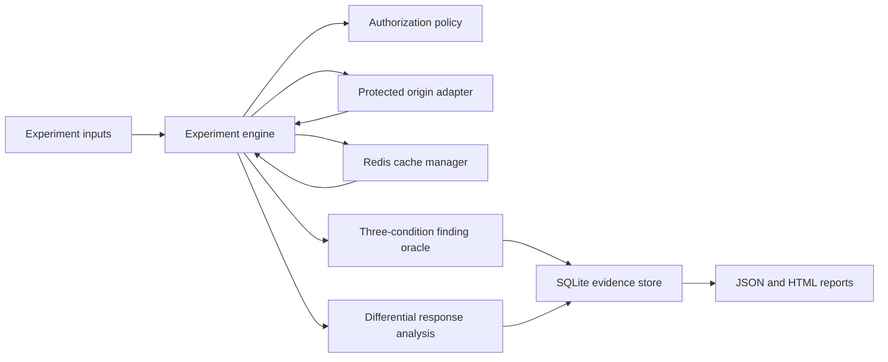
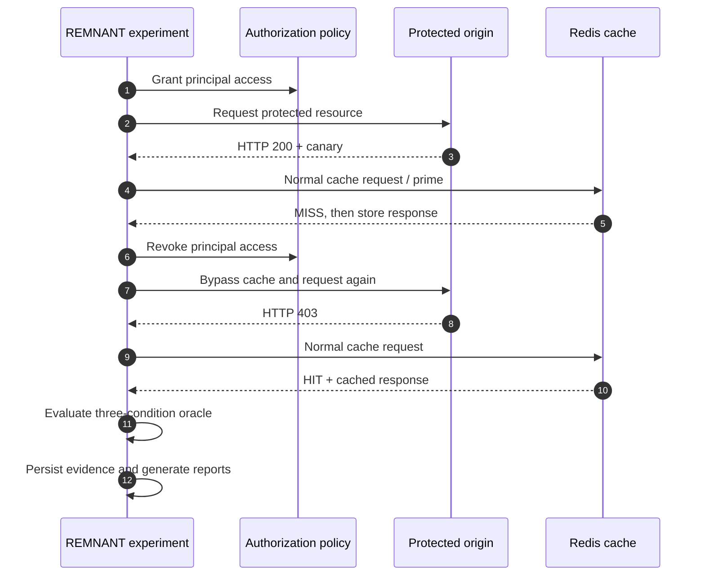

# REMNANT

<p align="center">
  <strong>Stateful Cache–Authorization Consistency Testing Framework</strong><br>
  A controlled experiment for testing whether a cached protected response remains available after origin authorization is revoked.
</p>

<p align="center">
  <a href="https://github.com/trilochan-prabakar/REMNANT/actions/workflows/tests.yml"></a>
  
  
  <a href="https://github.com/trilochan-prabakar/REMNANT/releases/tag/v2.0.0"></a>
  <a href="LICENSE"></a>
</p>

REMNANT is a Python security-testing framework for one focused question: **after a user's access is revoked, can the normal cache path still return a protected response that the origin now denies?**

It runs a controlled grant → cache → revoke → replay experiment against a sample protected origin and Redis. A finding is confirmed only when the origin returns HTTP 403, the normal cache path reports a hit, and the cached response contains the expected resource canary.

V2 builds on the original experiment with explicit cache-state observations, versioned metadata, differential response diagnostics, a separately selectable tenant-aware policy path, transactional SQLite evidence, and JSON/standalone HTML reports. It preserves the original three-condition finding oracle and legacy result/report compatibility.

> **Important scope boundary:** REMNANT is a controlled research and testing harness—not a general-purpose vulnerability scanner or production authorization system. It tests only the principal, resource, origin, cache path, and conditions exercised in a run. A negative result does not prove that a target is free of cache-related authorization flaws.

## At a glance

- **Authorization replay:** grant access, prime Redis, revoke access, query the origin directly, then query through the cache.
- **Strict finding criteria:** a cache hit alone is never treated as a finding.
- **Cache diagnostics:** distinguish `HIT`, `MISS`, `EXPIRED`, `UNKNOWN`, `BACKEND_ERROR`, and `INVALID_METADATA`.
- **Response analysis:** compare HTTP status, selected headers, body digest, and resource canary.
- **Tenant-aware path:** exercise a separately selectable default-deny policy engine with tenant boundaries.
- **Evidence:** persist body-free analysis alongside the six legacy evidence stages in SQLite; generate JSON and standalone HTML reports.
- **Robustness tests:** cover real loopback HTTP, Redis integration, transient backend failures, recovery, and bounded concurrent runs.

## The finding oracle

A result is `CONFIRMED` only when **all three** conditions are true:

| Condition | Required observation |
|---|---|
| Origin denies | Cache-bypassed origin returns HTTP `403` after revocation |
| Cache hit | Normal cache path returns `HIT` |
| Expected resource returned | Cached response contains the expected resource canary |

```text
Origin HTTP 403
      AND
Cache path HIT
      AND
Expected resource canary matches
      =
   CONFIRMED
```

Differential response analysis is diagnostic evidence. It does not override or replace this three-condition oracle.

## Architecture

The experiment engine coordinates the authorization policy, protected origin, Redis cache, analysis, and evidence pipeline. The V2 tenant-aware policy is an explicitly selectable path; the legacy V1-compatible policy remains available.



### Interpreting a confirmed result

A confirmed result means the experiment observed all three required facts in the same run:

```text
origin_status       = 403
cache_observation   = HIT
canary_match        = true
finding_status      = CONFIRMED
```

If any condition is absent—for example, the cache misses, the origin does not deny access, or the canary does not match—the strict oracle does not confirm a finding. Cache diagnostics and differential comparisons remain useful evidence, but they are not substitutes for the oracle.

## Experiment flow



The default origin adapter uses an in-process FastAPI application through HTTPX ASGI transport. A loopback-only HTTP adapter is available for controlled network-boundary integration tests. Redis is a separate service.

## Architecture and design notes

| Component | Responsibility |
|---|---|
| Authorization | V1-compatible grant/revoke policy and separately selectable V2 tenant-aware PolicyEngine |
| Origin adapters | Protocol boundary, in-process ASGI adapter, and bounded loopback HTTP adapter |
| Cache manager | Redis response snapshots, TTL handling, cache observations, and metadata validation |
| Analysis | Differential comparison of selected response dimensions |
| Finding oracle | Exact three-condition decision; diagnostic analysis cannot independently confirm |
| Evidence store | Versioned, transactional SQLite persistence |
| Reporting | JSON schema 2.0 and standalone HTML; legacy schema 1.0 remains supported |

Further reading:
- [Architecture and experiment sequence](docs/architecture.md)
- [V2 tenant-aware experiment path](docs/v2-tenant-aware-experiment.md)
- [Security scope, assumptions, and limitations](docs/security-and-limitations.md)
- [V2 phase completion records](docs/v2-phase-1.md), [Phase 2](docs/v2-phase-2.md), [Phase 2.1](docs/v2-phase-2.1.md), [Phase 3](docs/v2-phase-3.md), [Phase 4](docs/v2-phase-4.md)

## Technology

- Python 3.12+
- FastAPI and HTTPX
- Redis 7
- SQLite (`sqlite3`)
- pytest
- Docker Compose for the local Redis service

## Requirements

- Python 3.12 or newer
- Docker Engine with Docker Compose, or another Redis 7 service reachable at `localhost:6379`
- Git

## Installation (Ubuntu / WSL2)

Install the Python environment tools if needed:

```bash
sudo apt update
sudo apt install -y python3.12 python3.12-venv python3-pip
```

Clone and install the project:

```bash
git clone https://github.com/trilochan-prabakar/REMNANT.git
cd REMNANT
python3.12 -m venv .venv
source .venv/bin/activate
python -m pip install --upgrade pip
python -m pip install -e '.[dev]'
```

Start Redis from the repository root:

```bash
docker compose up -d redis
docker compose ps
```

The Compose configuration publishes Redis on `localhost:6379` and uses the named volume `remnant_redis_data`. Integration tests use `redis://localhost:6379/0`, skip when Redis is unavailable, and use unique key prefixes rather than flushing the database.

## Run the tests

```bash
python -m pytest -q
```

The full test suite includes unit tests and tests that exercise a real local Redis service. The GitHub Actions workflow runs Python 3.12 with Redis 7.

## Run a complete experiment

With the virtual environment active and Redis running:

```bash
python - <<'PY'
import json
from uuid import uuid4

from redis import Redis

from remnant.cache.manager import RedisCacheManager
from remnant.engine.experiment import CacheReplayExperiment
from remnant.reporting import ReportGenerator
from remnant.storage import SQLiteEvidenceStore

redis = Redis.from_url(
    "redis://localhost:6379/0",
    socket_connect_timeout=2,
    socket_timeout=2,
)
redis.ping()

cache = RedisCacheManager(
    client=redis,
    key_prefix=f"remnant:demo:{uuid4().hex}:",
)
result = CacheReplayExperiment(cache=cache).run(
    "alice",
    "document-1",
    ttl_seconds=60,
)

if result.finding_status != "CONFIRMED":
    raise SystemExit(f"Expected a confirmed demo result: {result}")

store = SQLiteEvidenceStore("reports/evidence.sqlite3")
store.save_experiment(result)
saved = store.get_experiment(result.experiment_id)
assert saved is not None and len(saved["evidence"]) == 6

generator = ReportGenerator(store, "reports/generated")
json_path = generator.generate_json(result.experiment_id)
html_path = generator.generate_html(result.experiment_id)

report = json.loads(json_path.read_text(encoding="utf-8"))
assert report["finding_status"] == "CONFIRMED"
assert report["oracle"]["finding_confirmed"] is True
assert html_path.is_file()
assert "CONFIRMED" in html_path.read_text(encoding="utf-8")

print(f"Experiment: {result.experiment_id}")
print(f"Finding: {result.finding_status}")
print(f"Evidence stages reloaded: {len(saved['evidence'])}")
print(f"JSON report: {json_path}")
print(f"HTML report: {html_path}")
redis.close()
PY
```

Expected observations in the included demonstration:

| Stage | Expected result |
|---|---|
| Initial authorized origin request | HTTP 200 |
| Cache prime | MISS, response stored |
| Permission revocation | Successful |
| Cache-bypassed origin request | HTTP 403 |
| Normal cache request | HIT |
| Canary comparison | Match |
| Finding | **CONFIRMED** |

The generated experiment ID links the result, SQLite record, and both reports. Runtime output is written under `reports/`, which is ignored by Git except for its tracked placeholder.

### Example confirmed outcome

The demonstration should end with the following key result fields (the experiment ID and report paths vary by run):

```text
Finding: CONFIRMED
Evidence stages reloaded: 6
JSON report: reports/generated/<experiment-id>.json
HTML report: reports/generated/<experiment-id>.html
```

This is an output-shape example, not a captured terminal recording. The executable demo above is the source of truth for reproducing it.

## Project layout

```text
.
├── docs/                 # Architecture, security notes, phase records
├── src/remnant/
│   ├── analysis/         # Differential analysis and finding oracle
│   ├── api/              # Protected origin applications
│   ├── auth/             # V1 policy and V2 authorization foundation
│   ├── cache/            # Redis cache manager and metadata
│   ├── engine/           # Experiment orchestration
│   ├── origin/            # Origin adapter implementations
│   ├── reporting/        # JSON and standalone HTML reports
│   └── storage/          # SQLite evidence persistence
├── tests/                # Unit, integration, recovery, and concurrency tests
├── docker-compose.yml
└── pyproject.toml
```

There is no packaged command-line interface in this release. Experiments are run through the Python package interfaces.

## Security assumptions and limitations

- The default authorization policy and sample resource catalogue are in-memory fixtures; policy state does not survive process restarts.
- The default origin is an in-process ASGI application. The loopback adapter is restricted to literal loopback addresses and explicit ports; REMNANT does not automatically scan arbitrary remote services.
- The included origin uses fixed sample resources and treats the supplied principal identifier as test input, not authenticated identity.
- The V2 PolicyEngine path uses in-memory identity, tenant, resource, and permission registries. It is not a production identity provider.
- The SHA-256 body digest detects inconsistency between a response and its accompanying digest. Because both are stored together, it is not an authenticity guarantee against an actor who can rewrite the Redis payload.
- Concurrency tests verify bounded run isolation and atomic replacement of one serialized Redis value. They do not claim distributed linearizability or thread-safety for shared mutable policy objects.
- A `NOT_FOUND` result means the three finding conditions were not all observed in that run. It does not prove that the target system is free of cache-related authorization flaws.
- The harness does not model every cache product, CDN, proxy, browser cache, invalidation policy, HTTP caching directive, or production deployment topology.

Read [Security and limitations](docs/security-and-limitations.md) before interpreting results. Use REMNANT only against systems and data you are authorized to test; the included demonstration targets its own sample origin.

## Project status

**Current release: [v2.0.0](https://github.com/trilochan-prabakar/REMNANT/releases/tag/v2.0.0).** V2 is complete and merged into `main`. Its test suite was reported as 215 passing locally in WSL and passed 215 tests in GitHub Actions before release.

The next version is intentionally not pre-scoped here. Further development should follow additional research, evaluation against relevant implementations, and clearly demonstrated gaps—not a feature checklist for its own sake.

See [CHANGELOG.md](CHANGELOG.md) for release history.
