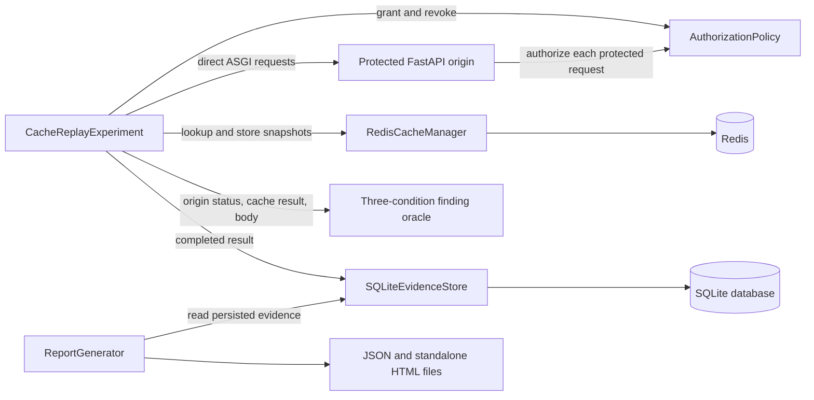
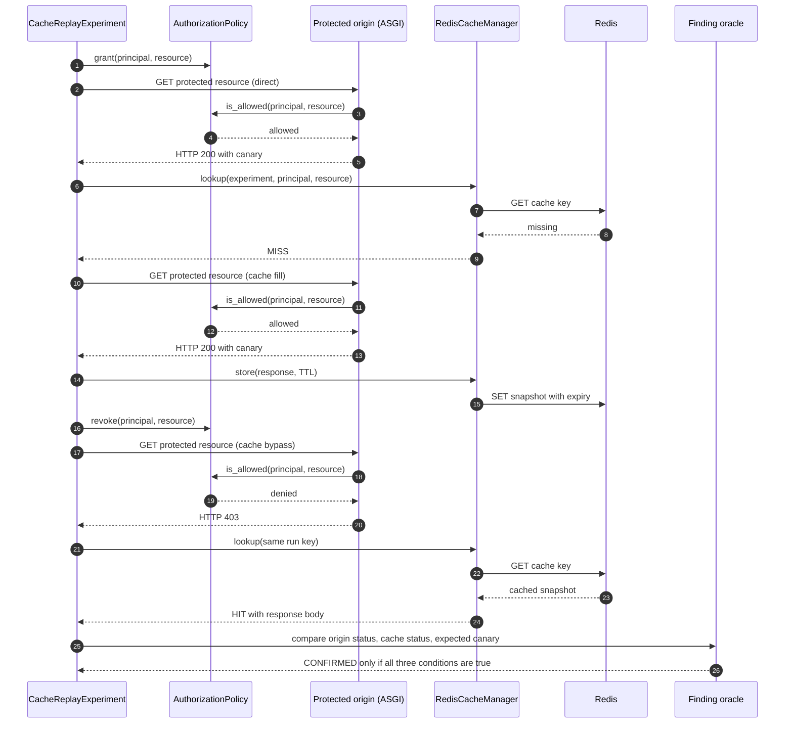

# REMNANT V1 architecture

This document describes the components implemented under `src/remnant/` and the flow exercised by `CacheReplayExperiment`.

## Components

### Authorization engine

`remnant.auth.models` defines `Principal`, `Role`, and `AuthorizationDecision`. `AuthorizationPolicy` in `remnant.auth.policy` maintains an in-memory set of `(principal_id, resource_id)` grants. A regular user is allowed only when that pair has an active grant. The policy also allows `Role.ADMIN`; the protected HTTP route and replay experiment construct principals as `Role.USER`.

### Protected origin

`remnant.api.app` provides `/health` and `GET /protected/{resource_id}?principal_id=...`. For protected requests, the route obtains the configured policy and checks it before returning a resource from the fixed in-memory resource map. Denied requests return HTTP 403. Authorized responses contain the resource ID, content, and stable canary. `create_protected_origin_app` creates an origin app bound to a supplied policy for isolated experiments.

The engine makes requests to this FastAPI app using HTTPX's `ASGITransport`; it does not start a separate network server.

### Redis Cache Manager

`remnant.cache.manager.RedisCacheManager` stores serialized `CachedHTTPResponse` snapshots in Redis. A stored snapshot preserves status code, headers, and body bytes and has a positive integer TTL. `lookup` returns `HIT` with the reconstructed response or `MISS`. The manager has no authorization policy and makes no authorization decisions.

The replay engine builds a cache key containing an experiment ID, principal ID, and resource ID. This isolates a replay entry to its run and tested identity/resource pair.

### Cache replay experiment and finding oracle

`remnant.engine.experiment.CacheReplayExperiment` coordinates the policy, origin app, and cache manager. On a miss, its normal cache path calls the origin and stores HTTP 200 responses. The experiment primes the cache while authorized, revokes the grant without deleting the entry, checks the origin directly, and then makes a normal cache request.

`evaluate_finding` returns the individual booleans and their conjunction:

1. `origin_denies`: the bypassed origin response is exactly HTTP 403.
2. `cache_hit`: the normal cache path returned `CacheStatus.HIT`.
3. `canary_matches`: the cached body parses as a JSON object whose `canary` equals the expected canary.

Only the conjunction confirms a finding. Malformed JSON, a missing or different canary, a cache miss, or an origin status other than 403 makes at least one condition false.

### SQLite evidence storage

`remnant.storage.sqlite.SQLiteEvidenceStore` uses Python `sqlite3`. It stores an experiment summary, six stage evidence rows, and the derived finding in one transaction. The schema uses foreign keys, checks, and indexes. `get_experiment`, `list_experiments`, and `get_confirmed_findings` read persisted values. Stages are derived from the returned experiment result; the store does not independently observe network traffic.

### JSON and HTML reporting

`remnant.reporting.reports.ReportGenerator` reads an experiment back from `SQLiteEvidenceStore`, then creates JSON or standalone HTML files in the caller-supplied output directory. It represents missing, failed, and successful stages; the HTML renderer escapes untrusted text and uses inline CSS without external assets. Report generation does not run an experiment or infer missing stage evidence.

## Component relationships

The diagram shows the current in-process composition. Redis is a separate service; the origin is an ASGI app called in-process by the runner.

## Cache replay sequence

If the normal cache lookup misses, the implementation calls the origin on that path. The miss cannot satisfy the cache-hit oracle condition.
