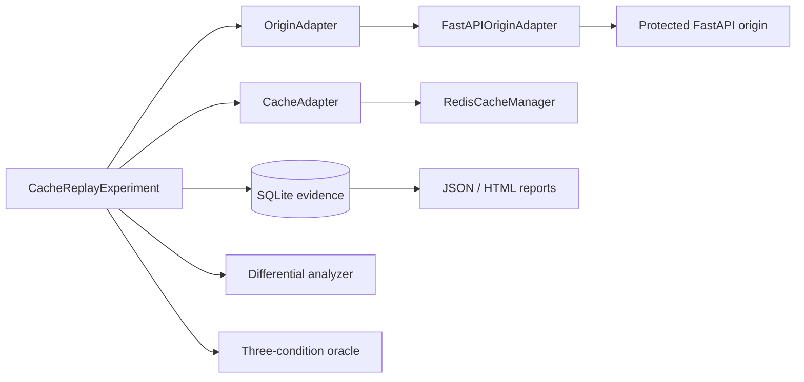

# REMNANT V2 Phase 3 — Evidence and Architecture Integration Design

**Status:** Proposed specification — review before implementation  
**Branch:** `remnant-v2-development`  
**Depends on:** V2 Phases 1, 2, and 2.1  
**Scope:** Integrate the normalized origin adapter and persist/report the V2 evidence already produced by the experiment.

## 1. Purpose

Phase 2.1 connected cache observations, metadata validation, the finding oracle, and differential analysis to `CacheReplayExperiment`. The current experiment still obtains origin responses through its private direct-ASGI helper, while the repository's `OriginAdapter` / `FastAPIOriginAdapter` contract is not the experiment's transport boundary. In addition, `ExperimentResult` exposes observation and differential summary fields, but SQLite and generated reports primarily persist the legacy six-stage V1 evidence.

Phase 3 closes these integration gaps. It is an evidence and architecture integration phase, not a new vulnerability-detection claim.

## 2. Goals

1. Make `CacheReplayExperiment` depend on the `OriginAdapter` contract for all direct and cache-fill origin requests.
2. Keep the FastAPI ASGI adapter as the default implementation and preserve existing constructor usage.
3. Record normalized origin/cache observation and differential evidence in `ExperimentResult` using additive, serializable fields.
4. Persist the new evidence in SQLite without breaking existing database files or V1 query/report consumers.
5. Extend JSON and HTML reports to show observation state, metadata integrity/identity summary, and differential dimensions.
6. Preserve the exact three-condition finding oracle and ensure differential results never confirm a finding independently.
7. Add end-to-end tests proving the full pipeline from adapters through persistence and report generation.
8. Update README and architecture/security documentation to describe V2 accurately.

## 3. Non-goals

- Changing the three-condition finding oracle.
- Integrating V2 `PolicyEngine` into the V1 replay scenario; that requires a separately designed V2 scenario/identity experiment and is not implied by Phase 3.
- Cache invalidation or revocation propagation strategies.
- TTL/revocation latency benchmarking or monotonic-time experiments.
- Concurrent request races, distributed replicas, network partitions, delayed/lost invalidations, or restart recovery.
- New cache products, remote deployment orchestration, arbitrary target scanning, browser/CDN testing.
- CLI/dashboard redesign, AI/ML, or production deployment claims.

## 4. Current contracts and compatibility constraints

### Origin

- `OriginAdapter.get_protected(resource_id, *, principal_id)` is asynchronous and returns `OriginResponse(status_code, headers, body)`.
- `FastAPIOriginAdapter` wraps the existing FastAPI app through HTTPX `ASGITransport`.
- The origin performs its own authorization; the adapter must not inspect or mutate policy state.
- The current experiment constructor accepts `cache`, optional `policy`, and optional `origin_app`. These forms must continue to work.

### Cache and finding

- `RedisCacheManager.observe()` returns the explicit V2 observation states.
- A valid cache HIT must include metadata whose principal and resource match the current experiment request.
- The finding is confirmed only when the direct origin returns HTTP 403, the normal cache observation is HIT, and the cached JSON canary equals the expected canary.
- Differential analysis is supporting evidence only.

### Public compatibility

- Preserve existing `ExperimentResult` fields and their meanings.
- New fields must be additive and have defaults so older direct construction patterns remain valid where possible.
- Preserve `CacheStatus`, `CacheResult`, `CachedHTTPResponse`, `evaluate_finding()`, and the `FindingOracle` return shape.
- Preserve the six existing V1 evidence stage names and the current report schema fields. New report data is additive and the report schema version must be incremented deliberately.
- Do not silently reinterpret a legacy `MISS` as `BACKEND_ERROR` or `INVALID_METADATA`.

## 5. Proposed architecture

The experiment coordinates adapters and pure analysis. Cache adapters remain storage-only. Origin adapters remain transport-only. Neither adapter makes authorization decisions on behalf of the origin.

## 6. Origin adapter integration

### Constructor

Add an optional `origin_adapter: OriginAdapter | None = None` keyword argument.

Resolution rules:
1. If `origin_adapter` is supplied, use it for all origin calls.
2. If no adapter is supplied and `origin_app` is supplied, construct `FastAPIOriginAdapter(origin_app)`.
3. If neither is supplied, construct the existing default protected origin app and wrap it in `FastAPIOriginAdapter`.
4. Preserve existing policy selection/identity checks for the `origin_app` path.
5. If both `origin_adapter` and `origin_app` are supplied, reject the ambiguous combination unless the adapter explicitly exposes and is validated against the same app. Prefer rejecting with a clear `ValueError` in this phase.

### Sync experiment boundary

`CacheReplayExperiment.run()` remains synchronous for V1 compatibility. Add one private helper that runs the adapter's async method using the current sync boundary. It must:
- use `asyncio.run` when no event loop is already running;
- detect an already-running event loop and raise a clear, documented `RuntimeError` rather than deadlocking or nesting event loops;
- normalize only the declared `OriginResponse` contract;
- allow adapter transport errors to propagate as an experiment failure, not convert them into HTTP 403 or a cache miss.

The experiment's direct post-revocation request and authorized cache-fill request must both use this adapter. No direct HTTPX or FastAPI transport code should remain in the engine.

## 7. Experiment evidence model

Keep the current legacy fields. Add an immutable, JSON-serializable evidence structure or additive optional fields to capture:

- origin response status and selected headers summary for the initial authorization, cache-fill, and post-revocation direct request;
- cache observation status for cache priming and post-revocation replay;
- metadata presence, schema version, principal/resource/tenant identity summary, response status, creation/expiry timestamps, and body digest;
- differential overall state and each dimension: status code, selected headers, body digest, canary;
- safe diagnostic categories for indeterminate/error outcomes.

### Data minimization

- Never persist full protected response bodies in SQLite or reports.
- Never persist credentials, authorization tokens, or arbitrary request headers.
- Persist only selected header names/values required by the current comparison policy. If values may contain sensitive data, store comparison state and digests rather than raw values.
- Do not expose the full cache key; it contains identity dimensions and experiment-specific identifiers.
- Store body digests and metadata digests, not body bytes.

### Oracle separation

The finding oracle remains authoritative for `CONFIRMED` / `NOT_FOUND`. Differential state may be `MATCH`, `DIFFERENT`, or `INDETERMINATE` and must not be folded into the oracle conjunction. A differential `MATCH` does not establish authorization correctness; a differential `DIFFERENT` does not by itself establish a cache authorization vulnerability.

## 8. SQLite persistence and migration

### Migration strategy

Do not destructively rebuild existing tables. Introduce a schema version table (or equivalent explicit version marker) and an additive migration that creates a dedicated `experiment_analysis` table keyed by `experiment_id` with a foreign key to `experiments`.

Suggested columns:
- `experiment_id` primary key / foreign key;
- `cache_observation_status`;
- `differential_state`;
- `analysis_json` containing validated, versioned, body-free analysis evidence;
- `analysis_schema_version`;
- `created_at`.

Keep the existing `experiments`, `experiment_evidence`, and `findings` tables and their constraints unchanged in this phase. Existing databases must open and migrate automatically and idempotently. Fresh databases must be created at the latest schema version. Migration must be transactional; unsupported future schema versions must fail clearly rather than downgrade.

### Persistence API

- `save_experiment()` continues to write the legacy summary, six evidence stages, and finding atomically.
- Extend that transaction to insert the analysis record when V2 evidence is present.
- Legacy `ExperimentResult` objects without V2 evidence remain storable and produce no analysis row.
- `get_experiment()` returns an additive `analysis` object or `None`.
- Existing `list_experiments()` and `get_confirmed_findings()` return shapes remain unchanged unless an additive field is proven necessary.

## 9. Reporting

### JSON

- Increment `report_schema_version` to `2.0` only when the new fields are actually emitted.
- Keep all existing V1 top-level fields and stage records.
- Add an `analysis` object containing cache observation outcomes, metadata summary, differential overall state, per-dimension states, and safe diagnostics.
- For legacy database rows with no analysis record, emit `analysis: null` or omit it consistently; document the choice and test it.

### HTML

- Add an analysis section that presents observation status, metadata integrity/identity validation, differential state and per-dimension results.
- Continue escaping all untrusted strings.
- Do not render response bodies, secrets, full cache keys, or raw sensitive headers.
- Legacy reports must continue to render with an explicit “analysis not recorded” state rather than failing.

## 10. Error semantics

- Origin transport failures are experiment errors; they must not become a 403, a cache MISS, or a confirmed finding.
- Cache `BACKEND_ERROR` and `INVALID_METADATA` remain distinct observations and cannot satisfy the HIT oracle condition.
- Metadata identity mismatch becomes `INVALID_METADATA` for the experiment result and is retained as a safe diagnostic category.
- Missing origin/cache evidence makes differential analysis `INDETERMINATE`.
- Partial evidence must never be represented as a completed, confirmed finding.

## 11. Testing requirements

### Adapter and engine tests
- Default constructor uses `FastAPIOriginAdapter`.
- Existing `policy` and `origin_app` constructor behavior remains valid.
- A fake `OriginAdapter` can drive the experiment without FastAPI internals.
- Initial, cache-fill, and post-revocation requests all use the adapter.
- Adapter transport errors propagate and cannot confirm findings.
- Running the synchronous experiment from an active event loop fails clearly.

### Evidence and persistence tests
- New experiment evidence is serializable and body-free.
- SQLite saves and reloads analysis evidence.
- Existing database schema migrates idempotently.
- Fresh databases use the latest schema.
- Legacy result objects and old database rows remain readable/reportable.
- Save transaction rolls back all summary/evidence/analysis writes on failure.

### Reporting tests
- JSON schema 2.0 includes all V2 analysis fields and retains V1 fields.
- HTML displays analysis and safely escapes untrusted values.
- Legacy records render without analysis.
- No response body or full cache key appears in JSON/HTML output.

### Regression
- Preserve exact three-condition oracle tests and negative controls.
- Preserve principal/resource cache isolation and real Redis integration behavior.
- Run full suite with Redis 7; integration tests must use unique prefixes and never flush Redis.

## 12. Acceptance criteria

Phase 3 is complete only when:
1. The experiment uses the `OriginAdapter` abstraction for every origin request.
2. The default FastAPI origin path and existing constructor call sites remain compatible.
3. V2 cache observation and differential evidence are available in the experiment result and persisted by SQLite.
4. SQLite migration is additive, transactional, idempotent, and tested against a pre-migration database.
5. JSON and HTML reports expose V2 analysis without leaking bodies, secrets, or full cache keys.
6. Legacy V1 records and public interfaces remain usable.
7. The exact finding oracle remains unchanged.
8. Full local and CI test suites pass, including real Redis integration tests.
9. README, architecture, and security/limitations docs accurately describe implemented behavior.
10. No Phase 4/5 or V3 scope is introduced.

## 13. Implementation order

1. Review and approve this specification.
2. Integrate `OriginAdapter` into the engine and add contract-driven engine tests.
3. Finalize the additive `ExperimentResult` evidence model.
4. Add SQLite schema versioning and additive analysis migration.
5. Extend JSON and HTML reporting with body-free analysis evidence.
6. Add end-to-end persistence/report tests and legacy database migration tests.
7. Update README, architecture, and security/limitations documentation.
8. Run full local and CI validation; record exact evidence in a Phase 3 completion document.

**Safety boundary:** Work only on `remnant-v2-development`. Keep PR #1 Draft. Do not merge, change PR readiness, or modify `main` without explicit user approval.
