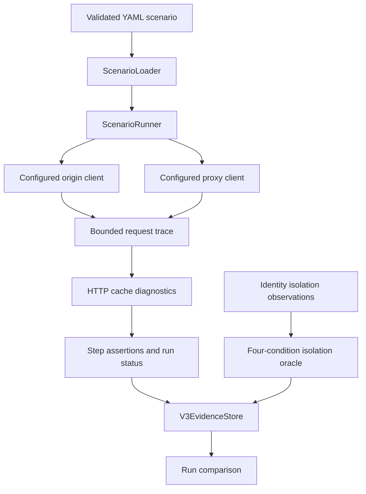

# REMNANT V3 architecture

This document describes the additive HTTP scenario architecture under `src/remnant/v3/`.
The V1/V2 Redis replay architecture remains documented separately in
[architecture.md](architecture.md).

## Design boundary

V3 is a controlled experiment runner, not a general-purpose scanner. The caller
constructs separate HTTPX clients for the origin and proxy. Scenario files select
only relative paths and GET/HEAD requests; they cannot choose hosts, follow
redirects, or execute code. State-changing fixture controls are disabled unless
the runner is explicitly constructed with `allow_control_operations=True`.

## Components

| Module | Responsibility |
|---|---|
| `scenarios.py` | Strict YAML parsing, schema validation, relative-path checks, request and fixture-control step models |
| `runner.py` | Bounded asynchronous requests, response-size limits, timeouts, no redirects, redacted body-free traces, PASS/FAIL/ERROR outcomes |
| `cache_analysis.py` | Diagnostic parsing of cache directives, freshness indicators, Vary, Set-Cookie, and common cache-state headers |
| `identity_isolation.py` | Independent four-condition oracle for cross-identity cached disclosure |
| `evidence.py` | Separate transactional SQLite schema, run comparison, and linked identity-isolation evidence |

## Request execution flow

The scenario runner records a digest and byte count of the captured response body,
but does not persist the body. Request header values are not included in traces;
sensitive query parameter values are redacted. Only an allowlist of response
headers is retained, and sensitive response headers such as Set-Cookie are omitted.

## Finding decisions

V3 keeps diagnostic cache analysis separate from security findings.

The stale-authorization replay oracle from V2 is unchanged and still requires its
three established observations. V3's cross-identity isolation oracle confirms
only when all four observations hold:

1. The requesting identity receives HTTP 403 directly from the origin.
2. The proxy returns HTTP 200 to that requester.
3. The proxy reports a cache HIT.
4. The response contains the expected canary belonging to a different identity.

Unknown or incomplete proxy observations are INDETERMINATE. Cache directives,
freshness estimates, cache-state headers, and Set-Cookie observations are
diagnostics; none independently confirms a vulnerability.

## Evidence schema and migration

V3 uses its own SQLite database and does not reuse or migrate the V1/V2 evidence
database. Schema version 1 stores scenario runs. Schema version 2 adds
`v3_identity_isolation`, linked to an existing run by a foreign key. The
migration is additive and leaves existing V3 run records intact.

The linked identity-isolation record stores the decision status, requester and
owner labels, origin/proxy status codes, cache-hit and canary-match booleans, and
the decision reason. It does not store the response body or the canary value.

## Concurrency and stateful controls

Read-only scenarios can be submitted to `run_many` with a bounded concurrency
limit. Scenarios containing grant, revoke, resource-update, or PURGE controls are
rejected by `run_many`. Those operations mutate shared fixture state and could
otherwise interleave across runs. Execute each lifecycle scenario individually
against a dedicated/reset fixture.

This batch guard does not coordinate separate processes or independently created
runner instances. Operators must still isolate fixtures when running multiple
processes or manually scheduling concurrent stateful runs.

## Real proxy integration

The repository includes a local Varnish 7.6 fixture. It deliberately demonstrates
stale authorization replay, cross-principal cache-key collision, stale resource
content after an origin update, and explicit PURGE invalidation. It is
intentionally vulnerable and must never be deployed as a production VCL.

The existing Nginx fixture remains a separate V2 integration demonstration.
Neither fixture establishes coverage of every proxy, CDN, browser cache, or
production deployment.

## Validation

The dedicated GitHub Actions workflow runs on pull requests to `main`, pushes
to `main`, and manual dispatch.
It runs the complete Python regression suite, compiles the V3 package, and runs
the isolated Varnish 7.6 integration. The main project workflow separately runs
the Redis-backed regression suite, Docker demo, and Nginx integration.
